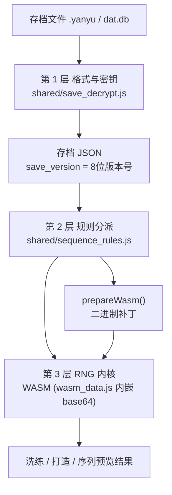

# 新版存档序列生成机制（含 73440）

> 结论先说：**随机序列的真正算法在 WASM 二进制里**，JS 只负责"解密 + 开关 + 喂参数 + 事后纠正"。
> 想适配新游戏版本，先判断改动落在哪一层 —— 大多数情况下只需要往密钥表里加一行。

代码位置：`extracted/assets/web/shared/`（本仓库 `yyjh_web/shared/`）。

---

## 总览：三层结构



---

## 第 1 层：存档格式与密钥（`shared/save_decrypt.js`）

游戏里**两套格式并存**，靠文件名 / 内容嗅探区分。

### (a) 嵌套新版格式（`.yanyu`，v2.1）

```
marker(8 字节 ASCII) + base64( XXTEA( 内层密文, 内层解析码(16 字节) ) )
```

- `SAVE_NESTED_MARKER_MAP` —— marker ↔ 已知版本号列表

  | marker | 已知版本号 |
  | --- | --- |
  | `kjie00o0` | 72280 |
  | `js9qf8me` | 72288 |
  | `nfidfug8` | 72294 / 73288 |
  | `tsidfug8` | 73288 |
  | `cdexdmk5` | 73302 |
  | `dnkemiea` | 73314 / **73420** |

- `SAVE_NESTED_INNER_KEY_MAP` —— 版本号 → 内层解析码

  | 版本号 | 内层解析码 |
  | --- | --- |
  | `00072280` | `hjo0e3q9po06ewkx` |
  | `00072288` | `jkds85wepo06ewkx` |
  | `00072294` | `juhycd8epo06ewkx` |
  | `00073288` | `90qabeonpo06ewkx` |
  | `00073302` | `njglp5lvpo06ewkx` |
  | `00073314` | `jkimeiccpo06ewkx` |
  | `00073420` | `n0b06b00po06ewkx` |

- 内层密文解开后**可能还是** `marker + base64`（再套一层），代码是循环剥的。
- 当前游戏版本 `00073440` 用的 marker 仍是 `dnkemiea`，
  内层解析码为 **`pon1dxg7po06ewkx`**，版本号 `00073440`。

### (b) v1.8 格式（`formattter/*.db` 那种）

```
base64( 版本号(8) + XXTEA( zlib(JSON), 平台固定密钥 ) )
```

注意与 (a) 的本质区别：**v1.8 的密钥不随版本号推导**，
而是按固定顺序逐个试平台固定密钥（`_getV18PlatformOrder()`）：

```
ios / android / pre_ios / pre_android / older / oversea / korea / japan / test / windows
```

具体密钥见 `SAVE_V18_PLATFORM_KEYS`（例：`ios='3598gjjdtekelaw9'`，`android='3598gjjdtekelad9'`）。

---

## 第 2 层：规则分派（`shared/sequence_rules.js`）

一切判定都基于存档头里的 **8 位版本号**（`save_version`）和**渠道**（`save_channel`）。

```js
washRC(state)  = version >= 73420 || 国际服
makeMax(state) = (version >= 73420 && 非国际服 && 非先行服) ? 98999999 : 99999999
```

即：**73420 是一次规则分水岭**。打造序列抽数上限从 `99999999` 抬到 `98999999`，
洗练的 RC 判定也跟着变。73440 走的是 73420 那条分支。

### WASM 二进制补丁（`prepareWasm()`）

因为 WASM 里那 4 个常量是**编译期写死**的 i64，没法从 JS 侧传进去，
所以作者直接在二进制上打补丁：

1. 版本守卫：断言 `bytes.length === 393716` 且 FNV-1a 指纹 `=== 1496480125`，
   否则抛「未知 WASM 内核版本」。（作者注释说这是"防误伤"而非认证机制。）
2. 在 Global 段把 3 个全局改成 4 个，追加一个 **i64 mutable global**。
3. 在 Export 段追加导出名 `__make_draw_max`（指向 global index 3）。
4. 在 Code 段扫描模式

   ```
   [0x42, …leb(99999999), 0x10, …leb(822), 0x1a]      // i64.const 99999999; call 822; drop
   ```

   替换为 `[0x23, 3, 1, 1, 1]`（`global.get 3` + 3 个 `nop`），
   用 nop 填满原来 5 字节的位置 —— **函数体长度不变，所以索引全都不用改**。
5. 必须恰好命中 **4** 处（四个装备种子推进点），否则抛「WASM 装备推进补丁校验失败」。
6. 最后 `WebAssembly.validate()` 校验补丁结果。

打补丁之后，`core_glue.js` 里 `make_set_state` 被接受时执行：

```js
wasmExports.__make_draw_max.value = BigInt(SequenceRules.makeMax(stateObj));
wasmMakeRuleContext = { save_version: …, save_channel: … };
```

也就是**用注册表把 JS 侧算出的版本规则注入内核**。

---

## 第 3 层：RNG 内核（WASM）

源码：`shared/wasm_data.js` 里的 `EMBEDDED_WASM_B64`（约 514 KB base64，解码后 393716 字节）。
`core_glue.js` 的装载策略：

- `location.protocol !== 'file:'` → 先 `fetch('pkg/wasm_core_bg.wasm')`；
- 失败则**无条件降级**用内嵌 base64（所以本仓库没有 `pkg/` 目录也没关系）。

主要导出：

| 分类 | 导出 |
| --- | --- |
| 生命周期 | `init_engine`、`set_state` / `get_state` |
| 洗练 | `do_wash`、`wash_multi`、`preview_sequence` |
| 打造（MakeRnd） | `make_init_tables`、`make_set_state`、`make_preview`、`make_once` |
| 其它 | `xilian_*`、`strong_*`（经 `_callJsonInOut` 走 JSON 进出） |

**JS 侧只做两件事，不参与算法：**

1. **喂参数** —— 把 `MakeRnd`（`Seeds / LuckySeeds / IDSeeds / MakeLucky / S / CKL / CKI / CKS / DaZao / RedSeeds`）等状态交进去。
2. **事后纠正** —— `correctFixedOrangeExtsFromSource(req, result)`：
   对 5 星装备，用 `equip_data` 里的固定配置覆盖 `exts`，
   按 `FIXED_ORANGE_EXT_PROP_ORDER` 的 3 个槽位对齐。

---

## 要适配新游戏版本，改哪里？

按"改动落在哪一层"判断，从便宜到昂贵：

| 假设 | 需要改的地方 | 成本 |
| --- | --- | --- |
| 只换了嵌套格式的 marker / 内层解析码 | `SAVE_NESTED_MARKER_MAP`、`SAVE_NESTED_INNER_KEY_MAP` 各加一行 | 极低 |
| 只换了 v1.8 平台密钥 | `SAVE_V18_PLATFORM_KEYS` 加一项 + `_getV18PlatformOrder()` | 极低 |
| 只是版本号跨过 73420 这类分水岭 | `sequence_rules.js` 的 `washRC` / `makeMax` 阈值 | 低 |
| **RNG 算法本身变了** | **必须逆向游戏新的 `yyjh whale/res/elf`，重新生成 WASM 替换 `EMBEDDED_WASM_B64`** | 极高 |

最后一行是硬约束：作者原话是
*"The bundled kernel has no source/build project"* —— 我们手里只有编译产物，
没有可重新编译的工程。所以一旦内核算法变了，JS 层怎么改都没用。

### 现状判断（73440）

- 已知 `73440` 复用 `dnkemiea` marker 与 `>= 73420` 规则分支；
- 若 73440 仅更新格式层密钥 → 往表里加 `'00073440': 'pon1dxg7po06ewkx'` 即可；
- 若 73440 改了 RNG → 需逆向内核。
  （因此 Python 工具侧才能对同一份存档用两套规则分别"还原"，这正是新版序列
  和 1.8 序列不再一致的原因。）
